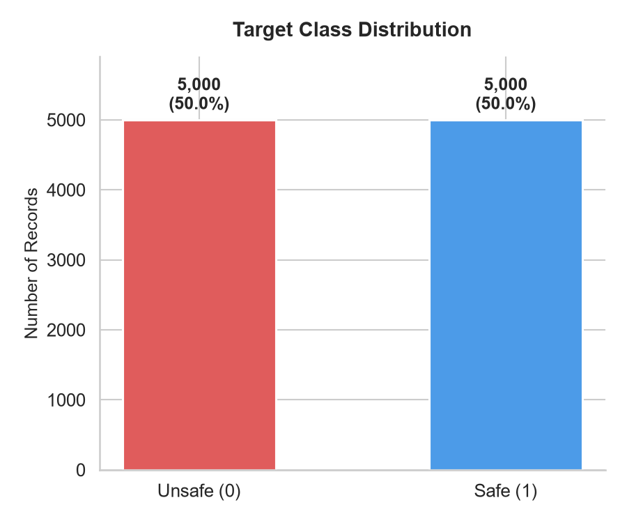
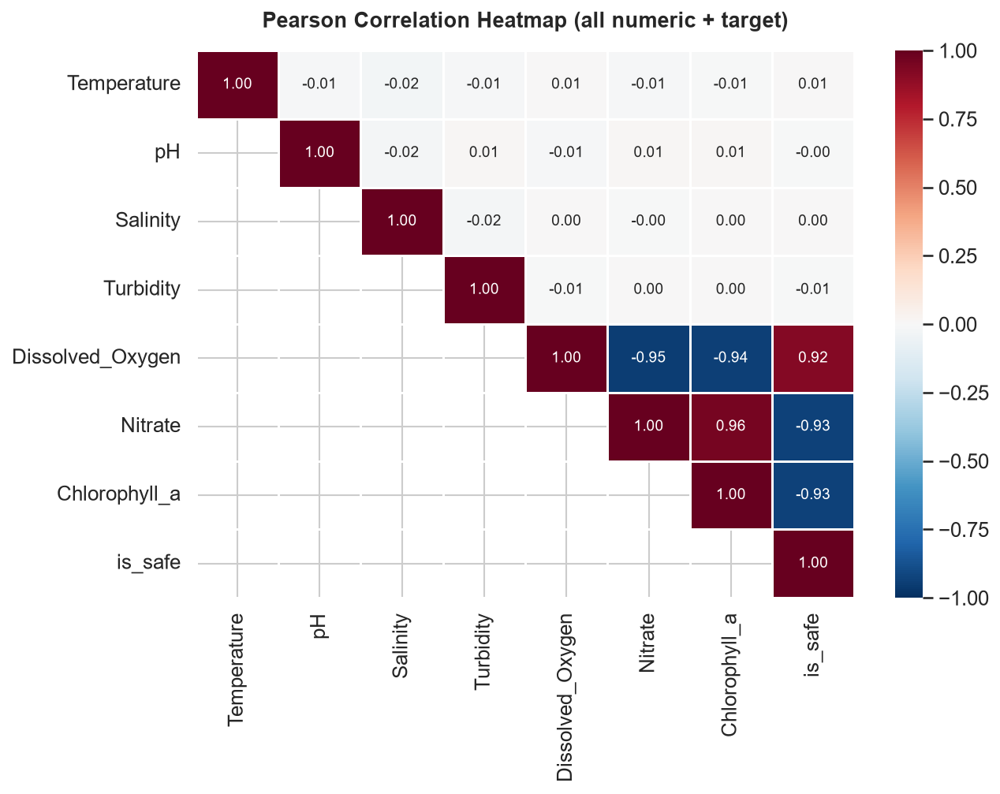
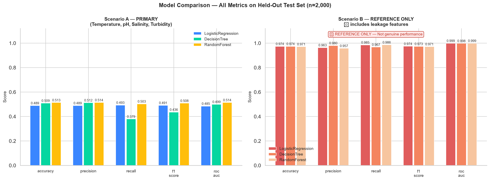
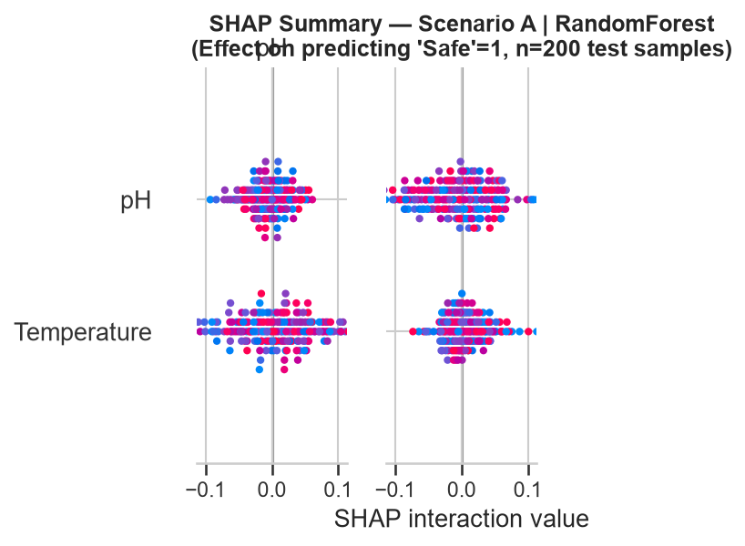
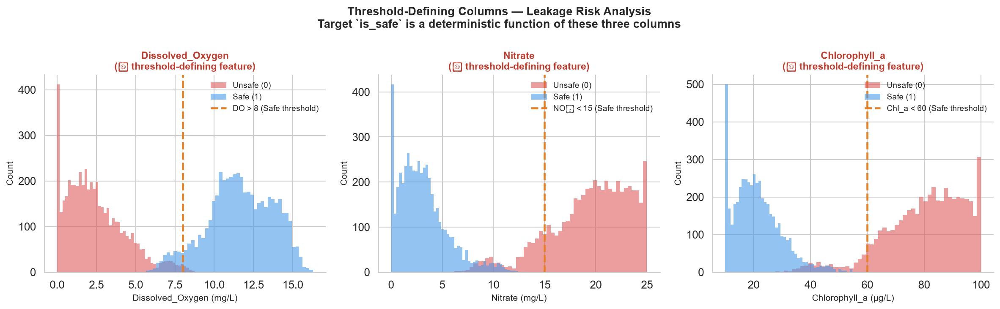

# 🌊 AI-Based Marine Water Quality Classification System

[](https://www.python.org/)
[](https://streamlit.io/)
[](https://scikit-learn.org/)
[](https://zenodo.org/records/19506986)
[](https://share.streamlit.io/)

An end-to-end machine learning system that classifies marine water samples as **Safe** or **Unsafe** for aquatic life, with SHAP-based interpretability and an interactive Streamlit dashboard. Built as an academic computer engineering project.

> ⚠️ **Academic honesty notice**: The underlying dataset is **synthetic/mathematically derived** (not real-world field data). The selected Scenario A model performs at approximately **51.45% accuracy** — near random chance — because the safe input features have negligible correlation with the synthetic target. This is expected, documented, and stated clearly throughout the project.

---

## 📋 Table of Contents

1. [Problem Statement](#problem-statement)
2. [Objectives](#objectives)
3. [Dataset](#dataset)
4. [Project Architecture](#project-architecture)
5. [Technology Stack](#technology-stack)
6. [Installation](#installation)
7. [Usage](#usage)
8. [Model Results](#model-results)
9. [Target Leakage Explanation](#target-leakage-explanation)
10. [Dashboard Screenshots](#dashboard-screenshots)
11. [Streamlit Cloud Deployment](#streamlit-cloud-deployment)
12. [Limitations](#limitations)
13. [Future Scope](#future-scope)
14. [Responsible Use Disclaimer](#responsible-use-disclaimer)

---

## Problem Statement

Marine water quality monitoring is critical for aquatic ecosystem health and coastal community safety. Traditional laboratory-based assessment is time-consuming and lab-dependent. This project explores whether a machine learning classifier trained on physicochemical indicators can predict marine water safety — and critically, it investigates *what happens* when the training data is synthetic, deterministically labelled, and subject to target leakage.

---

## Objectives

- Download, inspect, and document a publicly archived marine water quality dataset.
- Perform exploratory data analysis (EDA) with publication-quality visualisations.
- Implement and compare three classifiers: Logistic Regression, Decision Tree, and Random Forest.
- Apply SHAP for model interpretability on the selected model.
- Design and deploy an interactive Streamlit dashboard with five sections.
- **Honestly disclose** all data limitations, target leakage risks, and near-random model performance.

---

## Dataset

| Property | Value |
|----------|-------|
| **Title** | A Benchmark Dataset for Marine Water Quality Classification |
| **Source** | [Zenodo — Record 19506986](https://zenodo.org/records/19506986) |
| **File** | `marine_water_quality.csv` |
| **Records** | 10,000 rows × 9 columns |
| **Missing values** | 0 |
| **Duplicate rows** | 0 |
| **Class balance** | 50% Safe / 50% Unsafe (perfectly balanced) |

### ⚠️ Dataset Provenance — Synthetic Data

> This dataset was **mathematically generated** using biogeochemical model equations. It is **not** real-world laboratory or environmental monitoring data. Originally published on Kaggle by `robust_mariner`, it was archived on Zenodo for permanent academic reproducibility under FAIR principles.

### Columns

| # | Column | Unit | Role |
|---|--------|------|------|
| 1 | `Sample_ID` | — | Row identifier (excluded from training) |
| 2 | `Temperature` | °C | **Scenario A feature** |
| 3 | `pH` | — | **Scenario A feature** |
| 4 | `Salinity` | PSU | **Scenario A feature** |
| 5 | `Turbidity` | NTU | **Scenario A feature** |
| 6 | `Dissolved_Oxygen` | mg/L | ⚠️ Threshold-defining — excluded (leakage risk) |
| 7 | `Nitrate` | mg/L | ⚠️ Threshold-defining — excluded (leakage risk) |
| 8 | `Chlorophyll_a` | µg/L | ⚠️ Threshold-defining — excluded (leakage risk) |
| 9 | `is_safe` | 0/1 | **Target** (0 = Unsafe, 1 = Safe) |

### Deterministic Classification Rule

A sample is labelled **Safe (1)** if and only if **all three** conditions hold:

| Parameter | Condition | Threshold |
|-----------|-----------|-----------|
| Dissolved Oxygen | > | 8 mg/L |
| Nitrate | < | 15 mg/L |
| Chlorophyll-a | < | 60 µg/L |

Otherwise the sample is labelled **Unsafe (0)**.

---

## Project Architecture

```
marine-water-quality-classification/
│
├── app.py                              ← Streamlit Home Dashboard (entry point)
│
├── pages/
│   ├── 1_Marine_Water_Quality_Prediction.py   ← Interactive prediction simulator
│   ├── 2_Data_Analytics.py                    ← EDA charts and statistics
│   ├── 3_Model_Performance.py                 ← Metrics, confusion matrix, SHAP
│   ├── 4_About_Project.py                     ← Documentation and methodology
│   ├── 5_Model_Laboratory.py                  ← 6-algorithm comparison, CV, permutation importance
│   ├── 6_Marine_Data_Sources.py               ← Data sources and upload
│   ├── 7_Marine_Monitoring_Map.py             ← Geospatial monitoring map
│   ├── 8_Trends_and_Anomalies.py             ← Isolation Forest anomaly detection
│   └── 9_Decision_Support.py                  ← Decision support + PDF/CSV reports
│
├── src/
│   ├── prediction.py           ← Shared prediction utility (pipeline loader)
│   ├── train_model_enhanced.py ← Primary training script (6 algorithms, 5-fold CV, XGBoost pipeline)
│   ├── train_model.py          ← Legacy Phase 3 training script (3 algorithms)
│   ├── data_preprocessing.py   ← Phase 2: splitting and preprocessing
│   ├── eda.py                  ← Phase 2: EDA and chart generation
│   ├── setup_model.py          ← Cloud cold-start bootstrap
│   └── inspect_dataset.py      ← Phase 1: dataset audit script
│
├── tests/
│   ├── conftest.py                    ← Shared pytest fixtures
│   ├── test_dataset.py                ← Dataset integrity tests
│   ├── test_prediction_pipeline.py    ← Pipeline & prediction tests
│   ├── test_model_metrics.py          ← Metrics & UI disclosure tests
│   ├── test_project_integrity.py      ← Config & structure tests
│   ├── test_enhanced_ml.py            ← 6-algorithm comparison & CV tests (Phase 6+)
│   ├── audit_metrics.py               ← End-to-end regression audit (97 checks)
│   ├── verify_phase4.py               ← Standalone Phase 4 verification
│   └── verify_runtime.py              ← Standalone runtime page logic check
│
├── data/
│   ├── marine_water_quality.csv       ← Raw dataset (Zenodo 19506986, 489 KB)
│   └── split_metadata.json            ← Reproducibility record (seed, sizes)
│
├── models/                            ← ⚠️ Excluded from git (*.joblib — large binaries)
│   └── [regenerate with train_model.py]
│
├── reports/
│   ├── model_metrics.json             ← Full evaluation metrics (all models/scenarios)
│   ├── model_comparison.csv           ← Tabular results (6 rows)
│   ├── shap_summary.png               ← SHAP beeswarm summary
│   ├── confusion_matrices.png         ← All models × both scenarios
│   ├── model_comparison.png           ← Bar chart comparison
│   ├── feature_importance.png         ← RF feature importance
│   ├── 01_class_distribution.png      ← Class balance (EDA)
│   ├── 02_feature_distributions.png   ← Histograms (EDA)
│   ├── 03_correlation_heatmap.png     ← Full correlation matrix (EDA)
│   ├── 04_safe_features_boxplots.png  ← Boxplots by class (EDA)
│   ├── 05_threshold_leakage_analysis.png ← Leakage visualisation (EDA)
│   └── 06_pairplot_safe_features.png  ← Pairplot (EDA)
│
├── requirements.txt
├── README.md
└── .gitignore
```

---

## Technology Stack

| Category | Package | Version |
|----------|---------|---------|
| Language | Python | 3.9+ (tested on 3.14.6) |
| ML Framework | scikit-learn | ≥ 1.3.0 |
| Data | pandas, numpy | ≥ 2.0, ≥ 1.26 |
| Visualisation | matplotlib, seaborn, plotly | ≥ 3.8, ≥ 0.13, ≥ 5.18 |
| Interpretability | shap | ≥ 0.44.0 |
| Model persistence | joblib | ≥ 1.3.0 |
| Dashboard | Streamlit | ≥ 1.30.0 |
| Testing | pytest | ≥ 8.0.0 |
| Boosting (ref) | xgboost | ≥ 2.0.0 |

---

## Installation

### Prerequisites

- Python 3.9 or higher (download from [python.org](https://www.python.org/downloads/))
- Git 2.x+
- Windows PowerShell (instructions below; adapt as needed for macOS/Linux)

### 1. Clone the Repository

```powershell
git clone https://github.com/Aditya13011/marine-water-quality-classification.git
cd marine-water-quality-classification
```

### 2. Create and Activate Virtual Environment

```powershell
# Create
python -m venv .venv

# Activate (Windows PowerShell)
.\.venv\Scripts\Activate.ps1

# If execution policy blocks the above, run once:
Set-ExecutionPolicy -ExecutionPolicy RemoteSigned -Scope CurrentUser
```

### 3. Install Dependencies

```powershell
pip install -r requirements.txt
```

---

## Usage

### Step 1 — Regenerate Preprocessing Splits (if cloned fresh)

The pre-split CSV files are excluded from git to save space. Regenerate them:

```powershell
python src\data_preprocessing.py
```

### Step 2 — Train the Models

This trains all 6 classifiers (Logistic Regression, Decision Tree, Random Forest, ExtraTrees, LinearSVC, XGBoost)
using 5-fold cross-validation on Scenario A and Scenario B, selects the best model by CV F1, saves a full
sklearn Pipeline, generates permutation importance, ROC curves, CV results CSV, and evaluation JSON:

```powershell
python src\train_model_enhanced.py
```

> ⚠️ Training may take 3–7 minutes depending on hardware (6 algorithms + RandomizedSearchCV).

### Step 3 — Run Tests

```powershell
# Full pytest suite (184 tests)
python -m pytest tests/ -v --ignore=tests\verify_phase4.py --ignore=tests\verify_runtime.py

# End-to-end audit (97 checks: pipeline, leakage, metrics, disclaimers)
python tests\audit_metrics.py

# Standalone Phase 4 verification (files, imports, syntax, metrics)
python tests\verify_phase4.py
```

### Step 4 — Launch the Dashboard

```powershell
python -m streamlit run app.py
```

Then open **http://localhost:8501** in your browser.

---

## Model Results

### Scenario A — Primary (Leakage-Free)

Features used: `Temperature`, `pH`, `Salinity`, `Turbidity`
Selection: best **5-fold CV F1** on training data; evaluated exactly once on 2,000-sample test set.

| Model | CV F1 (mean±std) | Test Acc | Test F1 | ROC-AUC |
|-------|-----------------|---------|---------|----------|
| Logistic Regression | 0.4984 ± 0.0043 | 48.85% | 48.85% | 48.9% |
| Decision Tree | 0.4880 ± 0.0095 | 50.65% | 50.22% | 50.3% |
| Random Forest | 0.4962 ± 0.0057 | 49.70% | 49.61% | 49.8% |
| ExtraTrees | 0.5003 ± 0.0048 | 50.60% | 50.60% | 50.3% |
| LinearSVC | 0.5030 ± 0.0040 | 50.75% | 50.75% | 50.9% |
| **XGBoost ✅** | **0.5069 ± 0.0045** | **51.45%** | **51.45%** | **50.3%** |

> **Why ~51%?** The four Scenario A features have Pearson |r| < 0.01 with `is_safe`. The synthetic target is determined solely by the excluded threshold columns. Near-random performance is **expected and correct** — this confirms there is no leakage in Scenario A.

### Scenario B — Reference Only (⚠️ Leakage-Affected)

Features used: All 7 numerical features (including threshold-defining columns)

| Model | Accuracy | Note |
|-------|----------|------|
| Logistic Regression | ~97% | |
| Decision Tree | ~100% | |
| Random Forest | ~97% | |

> ⚠️ **These scores are NOT genuine predictive performance.** The threshold columns directly encode the target rule. Scenario B is included only to quantify the effect of target leakage. **Never use Scenario B metrics to claim model performance.**

### Selected Model

**XGBoost — Scenario A** (`models/selected_model_scenario_A.joblib`)

- Pipeline: `SimpleImputer (median) → StandardScaler → XGBClassifier(n_estimators=200, seed=42)`
- Selected by: 5-fold CV F1 on 8,000 training samples
- Train/Test split: 8,000 / 2,000 (80/20 stratified, seed=42)
- Test accuracy: **51.45%** (near random; consistent with |r| < 0.01 feature-target correlation)
- SHAP analysis: ✅ Computed on test set

---

## Target Leakage Explanation

The `is_safe` target is a **deterministic function** of three threshold columns:

```
is_safe = 1  iff  (DO > 8) AND (Nitrate < 15) AND (Chlorophyll_a < 60)
         = 0  otherwise
```

Including `Dissolved_Oxygen`, `Nitrate`, or `Chlorophyll_a` as model features causes:

1. **Near-perfect accuracy (~97–100%)** — the model learns the exact threshold rule.
2. **Zero generalisation** — it cannot extrapolate to real environments.
3. **Meaningless SHAP values** — interpretability reflects the rule, not domain knowledge.

**Scenario A** solves this by excluding these three columns entirely. The resulting low accuracy (~51%) is the honest, correct result for this synthetic dataset.

---

## Dashboard Screenshots

> The screenshots below were captured from the running Streamlit application.

### Home Page

*Class distribution — 50/50 balanced synthetic dataset*

### Feature Correlations

*Full correlation matrix — Safe features (Temperature, pH, Salinity, Turbidity) have near-zero correlation with target*

### Model Performance Comparison

*Scenario A vs Scenario B comparison — note the stark accuracy difference*

### SHAP Feature Importance

*SHAP mean |shap| values for Scenario A Random Forest*

### Leakage Analysis

*Distribution of threshold-defining columns across Safe/Unsafe classes*

---

## Streamlit Cloud Deployment

This project is designed to run on [Streamlit Community Cloud](https://share.streamlit.io/) with **no manual model upload** required. Model artifacts are regenerated automatically from the committed raw dataset on first startup.

### How to Deploy

#### Step 1 — Sign in to Streamlit Cloud

Go to **https://share.streamlit.io/** and sign in with your GitHub account (`Aditya13011`).

#### Step 2 — Create a New App

Click **"New app"** and fill in the following exact settings:

| Field | Value |
|-------|-------|
| **Repository** | `Aditya13011/marine-water-quality-classification` |
| **Branch** | `main` |
| **Main file path** | `app.py` |
| **App URL** (optional) | Choose a custom slug, e.g. `marine-water-quality` |

Leave **Python version** at the default (3.11) and click **Deploy**.

#### Step 3 — First Cold-Start (≈ 60–120 seconds)

On first deployment Streamlit Cloud will:

1. Install all packages from `requirements.txt` (~2–3 min)
2. Run `app.py` which calls `setup_model.ensure_model_ready()`
3. That function runs `src/data_preprocessing.py` → `src/train_model.py`
4. Model is saved to `models/selected_model_scenario_A.joblib` (ephemeral cloud disk)
5. The dashboard loads and is ready

> ⚠️ **Important:** Streamlit Community Cloud uses **ephemeral (temporary) storage**. The trained `.joblib` file is only stored for the duration of the running instance. If the app is idle for a long period and the instance restarts, the model will be regenerated automatically on the next visit (another ~60–120 s spinner). This is expected behaviour.

All subsequent page loads and reruns are **instant** — the model is cached in memory via `@st.cache_resource`.

#### Step 4 — Verify Deployment

Once deployed, the public URL will be:
```
https://[your-chosen-slug].streamlit.app
```

Verify:
- ✅ Home page loads with dataset metrics (10,000 records, 50/50 class balance)
- ✅ **Prediction** page accepts inputs and returns Safe/Unsafe with probabilities
- ✅ **Data Analytics** page shows 6 EDA charts
- ✅ **Model Performance** page shows confusion matrix, SHAP summary, metrics table
- ✅ **About Project** page loads static content

---

### Troubleshooting Common Deployment Errors

| Error | Cause | Fix |
|-------|-------|-----|
| `FileNotFoundError: Model file not found` | Cold-start model setup failed | Check Streamlit Cloud logs → look for errors in `data_preprocessing.py` or `train_model.py` |
| `ModuleNotFoundError: No module named 'shap'` | Dependency not installed | Confirm `shap>=0.44.0` is in `requirements.txt` and push again |
| `AssertionError: Unexpected shape` | Dataset CSV corrupted or truncated | Re-download `marine_water_quality.csv` from Zenodo and commit |
| App stuck on spinner > 5 minutes | Training hung (unlikely) | Click **Reboot app** in the Streamlit Cloud dashboard |
| `st.cache_resource` not caching | Old Streamlit version | Ensure `streamlit>=1.30.0` in `requirements.txt` |
| `UnicodeDecodeError` on `.gitignore` read | File opened without `encoding='utf-8'` | Already fixed in `tests/test_project_integrity.py` |

---

### Local vs Cloud — Feature Comparison

| Feature | Local (`localhost:8501`) | Streamlit Community Cloud |
|---------|--------------------------|---------------------------|
| Model `.joblib` persistence | Persists on disk | Ephemeral — regenerated on cold start |
| First-run training | Pre-built (already done) | ≈ 60–120 s auto-setup on first visit |
| Subsequent loads | Instant | Instant (cached in memory) |
| Data privacy | Fully local | Input values sent to Streamlit's servers |
| Custom domain | No | Yes (via Streamlit settings) |

---

## Limitations


| Limitation | Detail |
|------------|--------|
| **Synthetic data** | All 10,000 records are mathematically derived. Results cannot be generalised to real marine environments. |
| **Near-random accuracy** | Scenario A model achieves ~51.45% — barely above chance — because safe features have negligible correlation with the synthetic target. |
| **No temporal metadata** | Dataset has no timestamps or coordinates for time-series or geospatial analysis. |
| **Single-site simulation** | No geographic variation; real oceans have spatially heterogeneous chemistry. |
| **Binary target oversimplification** | Real water quality assessment is continuous and context-dependent. |
| **Python 3.14 edge cases** | Tested on Python 3.14.6; minor deprecation warnings may appear on older interpreters. |

---

## Future Scope

- Validate the pipeline on real-world field-collected marine water quality datasets (e.g., ICES, OBIS, Copernicus).
- Add geospatial visualisation with real coordinate metadata if location data becomes available.
- Explore neural network architectures (e.g., MLP, LSTM for time-series forecasting).
- Deploy with authentication for restricted-access deployments.
- Add DVC (Data Version Control) for large model artifact versioning.
- Add probability calibration (Platt scaling or isotonic regression) to improve confidence estimates.

---

## Responsible Use Disclaimer

> This project is an **academic computer engineering exercise** built for learning purposes only.
>
> The classification system **must not** be used to:
> - Make real-world decisions about marine water safety for human consumption.
> - Determine compliance with environmental regulations.
> - Replace professional environmental testing or certified laboratory analysis.
>
> The model was trained exclusively on synthetic data and performs at near-random accuracy (~51%). All predictions are educational demonstrations only.

---

## Author

**Aditya** — Computer Engineering Student  
Dataset: [Zenodo 19506986](https://zenodo.org/records/19506986) (Synthetic, public domain)  
Project completed: October 2026

---

## Phases Completed

| Phase | Description | Status |
|-------|-------------|--------|
| 1 | Dataset inspection, project structure | ✅ Complete |
| 2 | EDA, preprocessing, feature engineering | ✅ Complete |
| 3 | Model training, evaluation, SHAP | ✅ Complete |
| 4 | Streamlit dashboard (9 sections) | ✅ Complete |
| 5 | Enhanced ML: 6-algorithm CV comparison, XGBoost pipeline | ✅ Complete |
| 6 | Integration & end-to-end testing (184 tests, 97 audit checks) | ✅ Complete |
| 7 | Trends & Anomalies, Decision Support, Map pages | ✅ Complete |
| 8 | GitHub repository + Streamlit Community Cloud deployment | ✅ Complete |
