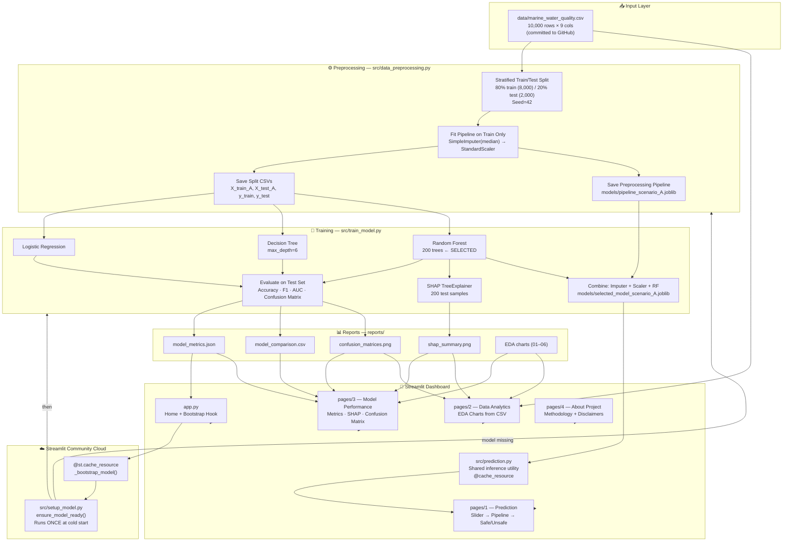

# System Architecture
## AI-Based Marine Water Quality Classification System

---

## 1. Overall Architecture Diagram



---

## 2. Directory Structure

```
marine-water-quality-classification/
│
├── app.py                              ← Streamlit entry point + cloud bootstrap
├── requirements.txt                    ← Production dependencies (no pytest/xgboost)
├── README.md                           ← Full project documentation
├── .gitignore                          ← Excludes .venv, *.joblib, split CSVs, cache
│
├── pages/                              ← Streamlit multi-page app
│   ├── 1_Marine_Water_Quality_Prediction.py
│   ├── 2_Data_Analytics.py
│   ├── 3_Model_Performance.py
│   └── 4_About_Project.py
│
├── src/                                ← Backend logic
│   ├── prediction.py          ← Shared inference: load pipeline, validate, predict
│   ├── setup_model.py         ← Cloud startup: regenerate artifacts if missing
│   ├── train_model.py         ← Phase 3: training, evaluation, SHAP, reports
│   ├── data_preprocessing.py  ← Phase 2: split, impute, scale, save
│   ├── eda.py                 ← Phase 2: EDA charts
│   └── inspect_dataset.py     ← Phase 1: dataset audit
│
├── data/                               ← Dataset files
│   ├── marine_water_quality.csv        ← Raw dataset (committed — 489 KB)
│   └── split_metadata.json            ← Reproducibility record (committed)
│   [X_train_A.csv, X_test_A.csv …]   ← Derived split CSVs (gitignored)
│
├── models/                             ← Model artifacts (ALL gitignored)
│   [selected_model_scenario_A.joblib] ← Full pipeline (imputer+scaler+RF, 12 MB)
│   [pipeline_scenario_A.joblib]       ← Preprocessing only
│
├── reports/                            ← Generated charts and metrics (committed)
│   ├── model_metrics.json
│   ├── model_comparison.csv
│   ├── shap_summary.png
│   ├── confusion_matrices.png
│   ├── model_comparison.png
│   ├── feature_importance.png
│   └── 01–06_*.png                    ← EDA charts
│
├── tests/                              ← Pytest test suite
│   ├── conftest.py
│   ├── test_dataset.py
│   ├── test_prediction_pipeline.py
│   ├── test_model_metrics.py
│   ├── test_project_integrity.py
│   ├── verify_phase4.py
│   └── verify_runtime.py
│
└── docs/                               ← Project documentation
    ├── PROJECT_REPORT.md
    ├── ARCHITECTURE.md                ← This file
    ├── VIVA_QUESTIONS.md
    ├── DEMO_GUIDE.md
    └── FINAL_CHECKLIST.md
```

---

## 3. Source File Explanations

### `app.py` — Home Dashboard + Cloud Bootstrap

- Sets Streamlit page config (title, icon, layout).
- Injects global dark-marine CSS theme via `st.markdown(unsafe_allow_html=True)`.
- Defines `@st.cache_resource _bootstrap_model()` — calls `setup_model.ensure_model_ready()` exactly once per server lifecycle.
- Displays: dataset metrics, selected model accuracy cards, feature table, classification rule, phase status badges.

### `src/prediction.py` — Shared Inference Utility

- Defines `MODEL_PATH`, `FEATURES`, `FEATURE_RANGES`, `FEATURE_UNITS` as module constants.
- `load_pipeline()`: lazy singleton — loads `.joblib` once and caches in `_pipeline` module variable.
- `validate_inputs()`: checks all four feature values are within observed dataset ranges.
- `predict()`: builds named `pd.DataFrame`, calls `pipeline.predict()` + `predict_proba()`, returns structured dict.
- `get_pipeline_info()`: returns steps, model type, feature names, scaler statistics for display.

### `src/setup_model.py` — Cloud Startup Script

- `model_exists()`: checks if `models/selected_model_scenario_A.joblib` is present.
- `ensure_model_ready()`: if model absent, runs `data_preprocessing.py` then `train_model.py` as subprocesses.
- Called by `app.py` via `@st.cache_resource` — runs once per server lifecycle only.

### `src/data_preprocessing.py` — Preprocessing Pipeline

- Loads raw CSV, validates shape and integrity.
- Defines two feature sets: `FEATURES_A` (4 cols) and `FEATURES_B` (7 cols).
- Performs stratified 80/20 split (seed=42).
- Fits `SimpleImputer → StandardScaler` on training data only.
- Saves processed CSVs, pipeline `.joblib` files, and `split_metadata.json`.

### `src/train_model.py` — Training and Evaluation

- Loads pre-scaled CSVs (does NOT re-scale).
- Trains three classifiers on both Scenario A and Scenario B.
- Evaluates each on the held-out test set.
- Selects best by F1-score; combines with preprocessor into a full pipeline.
- Runs SHAP analysis (TreeExplainer) on best Scenario A model.
- Saves `.joblib` pipelines, `model_metrics.json`, `model_comparison.csv`, all chart PNGs.

### `pages/` — Streamlit Multi-Page Components

Each page uses:
```python
ROOT = os.path.normpath(os.path.join(os.path.dirname(__file__), ".."))
sys.path.insert(0, os.path.join(ROOT, "src"))
```
This ensures imports work whether the app is run locally or on Streamlit Cloud (which sets `__file__` relative to the repo root).

---

## 4. Cloud Startup Flow (Detailed)

```
User visits https://[app].streamlit.app
         │
         ▼ (first cold start)
Streamlit Cloud installs requirements.txt (~2-3 min)
         │
         ▼
app.py is loaded by Streamlit
         │
         ▼
_bootstrap_model() is called
  [st.cache_resource ensures this runs ONCE]
         │
    model_exists()?
    ├── YES → ensure_model_ready() returns immediately
    │          Dashboard loads in ~1 second
    └── NO  → st.spinner shown to user: "⏳ First-time setup..."
               │
               ▼
          subprocess: python src/data_preprocessing.py
               → Reads data/marine_water_quality.csv (489 KB)
               → Writes X_train_A.csv, X_test_A.csv, y_train.csv, y_test.csv
               → Writes models/pipeline_scenario_A.joblib
               (~15 seconds)
               │
               ▼
          subprocess: python src/train_model.py
               → Trains 3 classifiers × 2 scenarios = 6 models
               → Random Forest (200 trees) takes ~60-90 seconds
               → Writes models/selected_model_scenario_A.joblib
               → Writes reports/ JSON and PNGs
               (~90-120 seconds total)
               │
               ▼
          ensure_model_ready() returns
          _bootstrap_model() returns True
          st.cache_resource caches the True result
               │
               ▼
Dashboard renders normally
Spinner disappears, user sees full app
```

---

## 5. Key Design Decisions

### Decision 1 — Two-Scenario Feature Design

**Rationale**: The dataset's target is a deterministic function of three columns. Including them would give near-100% accuracy from rule-memorisation. By defining Scenario A (without these columns) and Scenario B (with them), the project honestly separates genuine learning from leakage-driven accuracy.

**Alternative considered**: A single model with all features. Rejected because it would mislead evaluators about model quality.

### Decision 2 — Full sklearn Pipeline for Inference

**Rationale**: Bundling `SimpleImputer + StandardScaler + Classifier` into a single `Pipeline` ensures that raw (unscaled) user input is correctly preprocessed at prediction time. A common deployment mistake is applying the classifier to raw input, bypassing the scaler.

**Alternative considered**: Saving scaler and model separately. Rejected because it requires two load calls and is error-prone.

### Decision 3 — `@st.cache_resource` for Model Loading

**Rationale**: Streamlit reruns `app.py` on every user interaction. Without caching, the model would be loaded from disk on every button click. `@st.cache_resource` ensures the `.joblib` is loaded once and kept in memory for the server's lifetime.

### Decision 4 — Model Regeneration via Subprocess (not import)

**Rationale**: Running `data_preprocessing.py` and `train_model.py` as subprocesses avoids polluting `app.py`'s namespace with training dependencies. It also ensures the scripts run as standalone programs (with their own `__name__ == "__main__"` guards) exactly as they would when run manually.

### Decision 5 — Excluding `.joblib` from Git

**Rationale**: The Scenario A pipeline is 12 MB. Git is not designed for large binary files; they inflate repository size permanently and cause slow clones. The model is regenerated deterministically from the committed raw CSV. This is the standard practice (analogous to not committing compiled binaries).

---

## 6. Important Limitations of the Architecture

| Limitation | Detail | Mitigation |
|-----------|--------|-----------|
| Ephemeral cloud storage | Model lost when Streamlit instance restarts | Auto-regeneration via `setup_model.py` |
| 60–120 s cold start | Training RF on cloud CPU is slow | Spinner with explanation; cached after first run |
| No model versioning | No DVC or MLflow tracking | Planned for future scope |
| Single-node deployment | No load balancing | Sufficient for academic demonstration |
| Static dataset | Cannot retrain on new data | Planned for future scope with real datasets |
